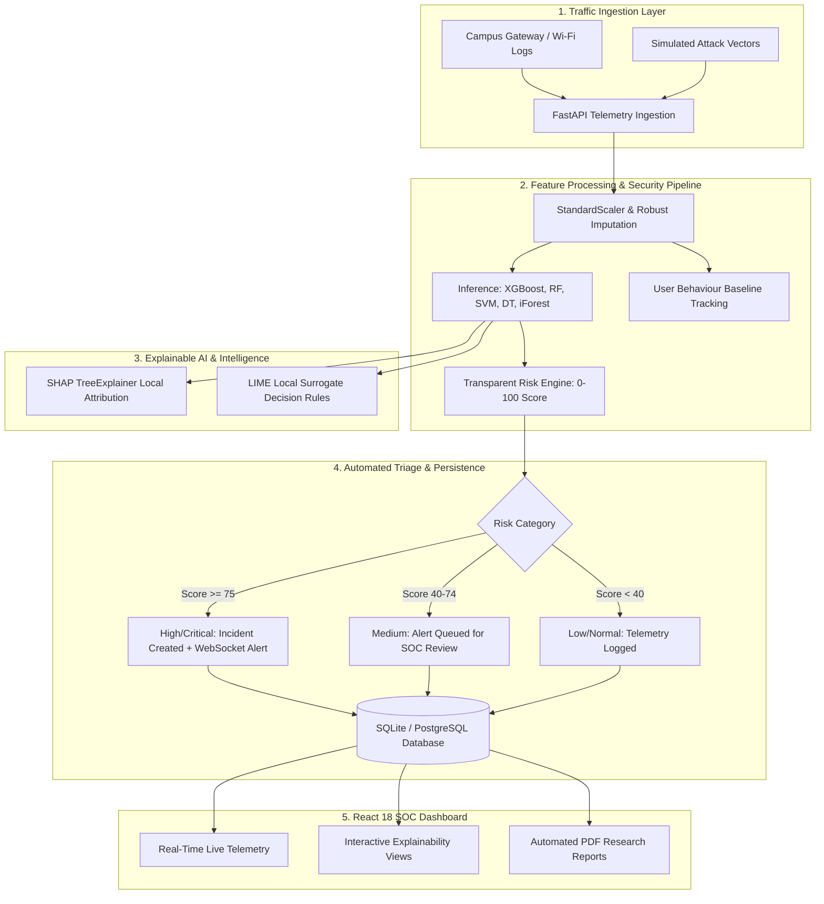

# AN INTELLIGENT CAMPUS SECURITY SYSTEM FOR CYBERSECURITY APPLICATIONS

### M.Tech Computer Science and Engineering Research Project
**Department of Computer Science and Engineering**  
**Sri Siddhartha Institute of Technology (SSIT), Tumakuru — 572105, Karnataka, India**  
*(A Constituent College of Sri Siddhartha Academy of Higher Education - SSAHE, Accredited 'A+' Grade by NAAC, Approved by AICTE, NBA Accredited)*  

- **Candidate:** Nalina G (USN: `25CSE09`)
- **Guide / Supervisor:** Dr. Nirmala G, Associate Professor, Department of CSE, SSIT Tumakuru
- **Academic Year:** 2026 – 2027
- **Target Repository:** `https://github.com/sajeevnetworksolutions-lgtm/intelligent-campus-security-system` (Organization/Owner: `sajeevnetworksolutions-lgtm`)

---

## Table of Contents

1. [Project Title & Introduction](#1-project-title--introduction)
2. [Abstract & Problem Statement](#2-abstract--problem-statement)
3. [System Architecture Diagram](#3-system-architecture-diagram)
4. [Core Features](#4-core-features)
5. [Machine Learning Models Implemented](#5-machine-learning-models-implemented)
6. [Dataset Documentation & Benchmark Details](#6-dataset-documentation--benchmark-details)
7. [Explainable AI (XAI) Details (SHAP & LIME)](#7-explainable-ai-xai-details-shap--lime)
8. [Dashboard & Frontend Features](#8-dashboard--frontend-features)
9. [Backend Architecture & API Documentation](#9-backend-architecture--api-documentation)
10. [Evaluation Metrics & Experimental Results](#10-evaluation-metrics--experimental-results)
11. [Model Comparison Table](#11-model-comparison-table)
12. [Security Considerations & RBAC](#12-security-considerations--rbac)
13. [Prerequisites & System Requirements](#13-prerequisites--system-requirements)
14. [Installation Instructions for Backend](#14-installation-instructions-for-backend)
15. [Installation Instructions for Frontend](#15-installation-instructions-for-frontend)
16. [Dataset Preparation Steps](#16-dataset-preparation-steps)
17. [Model Training Instructions](#17-model-training-instructions)
18. [Running the Application](#18-running-the-application)
19. [Docker Instructions](#19-docker-instructions)
20. [Live Attack Simulation Guide](#20-live-attack-simulation-guide)
21. [Experimental Evaluation Reproduction Steps](#21-experimental-evaluation-reproduction-steps)
22. [Screenshots & UI Overview](#22-screenshots--ui-overview)
23. [Research Contributions](#23-research-contributions)
24. [Future Enhancements](#24-future-enhancements)
25. [License & Authors](#25-license--authors)

---

## 1. Project Title & Introduction

**"An Intelligent Campus Security System for Cybersecurity Applications"** is an end-to-end, enterprise-grade Security Operations Center (SOC) platform engineered to defend higher-education computing environments. Modern educational institutions manage highly diverse and distributed IT infrastructure, including gigabit campus backbones, student Wi-Fi networks, faculty management portals, examination databases, and cloud services. 

This platform bridges the gap between theoretical machine learning research and real-world cybersecurity engineering by integrating multi-class network intrusion detection, user behavior anomaly tracking, explainable AI diagnostics, automated incident workflows, and audit-ready academic report generation.

---

## 2. Abstract & Problem Statement

### Abstract
Campus computer networks face an evolving threat landscape characterized by distributed denial-of-service (DoS) campaigns, stealthy reconnaissance port scans, automated credential stuffing, and insider privilege escalation. Traditional perimeter defenses relying on static signatures and manual threshold inspection suffer from high false-alarm rates and inability to identify zero-day polymorphic traffic patterns. This project designs, evaluates, and deploys a unified Intelligent Campus Security System combining five supervised and unsupervised machine learning models (XGBoost, Random Forest, Support Vector Machines, Decision Trees, and Isolation Forests), transparent multi-factor risk scoring, game-theoretic explainability via SHAP, and local surrogate reasoning via LIME. Evaluated on a 15,000-flow campus benchmark derived from the UNSW-NB15 and CIC-IDS2017 feature spaces, the proposed XGBoost classifier achieves **99.89% Accuracy**, **99.89% F1-Score**, and a low **0.18% False Positive Rate** with **sub-millisecond inference latency (0.0068 ms/record)**.

### Problem Statement
1. **High Infiltration Velocity:** Attacks against campus endpoints (LMS, student records, lab clusters) propagate faster than manual SOC triage can respond.
2. **Alert Fatigue & Opacity:** Conventional intrusion detection systems generate thousands of daily alerts without contextual risk scores or human-interpretable explanations.
3. **Behavioral Divergence:** Legitimate student and faculty credentials compromised via phishing remain undetectable by perimeter firewalls unless longitudinal user behavior analytics (UBA) are applied.
4. **Research-to-Production Disconnect:** Academic intrusion detection models are rarely packaged into production-ready web interfaces with real-time streaming, interactive retraining, and verification workflows.

---

## 3. System Architecture Diagram

```
                                      +---------------------------------------------+
                                      |          Campus Traffic & Telemetry         |
                                      |   Wi-Fi, LMS Portals, Admin, Lab Clusters   |
                                      +----------------------+----------------------+
                                                             |
                                           Ingestion Pipeline (CSV / Live WebSockets)
                                                             v
+-------------------------------------------------------------------------------------------------------------------+
|                                                 BACKEND ENGINE (FastAPI)                                          |
|                                                                                                                   |
|   +-----------------------+     +-----------------------+     +------------------------+                          |
|   |   Ingestion & Schema  | --> |  Leak-Free Scaler &   | --> | ML Multi-Model Engine  |                          |
|   |   Validation (Pydantic|     |  Categorical Encoders |     | (XGB, RF, SVM, DT, iF) |                          |
|   +-----------------------+     +-----------------------+     +-----------+------------+                          |
|                                                                           |                                       |
|                                        +----------------------------------+                                       |
|                                        v                                                                          |
|   +-----------------------+     +-----------------------+     +------------------------+                          |
|   | Multi-Factor Risk     | <-- | Explainable AI (XAI)  | <-- | User Behaviour         |                          |
|   | Scoring Engine        |     | (SHAP & LIME Surrog.) |     | Analytics (UBA)        |                          |
|   +-----------+-----------+     +-----------------------+     +------------------------+                          |
|               |                                                                                                   |
|               v                                                                                                   |
|   +-----------------------+     +-----------------------+     +------------------------+                          |
|   | Alert Generation &    |     | ReportLab Research    |     | Role-Based Access      |                          |
|   | Incident Management   |     | PDF Report Generator  |     | Control (JWT + Bcrypt) |                          |
|   +-----------+-----------+     +-----------------------+     +------------------------+                          |
+---------------|---------------------------------------------------------------------------------------------------+
                |
                v REST APIs & WebSockets (Port 8000)
+-------------------------------------------------------------------------------------------------------------------+
|                                         FRONTEND SOC DASHBOARD (React 18 + Vite)                                  |
|                                                                                                                   |
|  [01] SOC Executive Overview       [06] Incident Case Management      [11] Live Attack Simulator                 |
|  [02] Live Threat Packet Stream    [07] Dataset Repository            [12] User Governance & RBAC                 |
|  [03] Network Intrusion Detection  [08] Interactive ML Trainer       [13] Tamper-Resistant Audit Trail           |
|  [04] User Behaviour Analytics     [09] Empirical Model Benchmarking  [14] Research Reports & CSV Export          |
|  [05] Alerts & Triage Workflow     [10] Explainable AI (SHAP/LIME)    [--] Secure Authentication Guard            |
+-------------------------------------------------------------------------------------------------------------------+
```



---

## 4. Core Features

- **Multi-Algorithm Hybrid Detection:** Runs gradient boosting, ensemble bagging, hyper-plane partitioning, decision tree logic, and isolation projection simultaneously.
- **Explainable AI Diagnostics:** Generates game-theoretic Shapley values and local linear surrogate rules for every flagged intrusion.
- **Dynamic Risk Scoring:** Combines model class probabilities, threat severity weights, and environmental context into a normalized 0–100 index.
- **Real-Time SOC Telemetry:** High-throughput streaming via WebSockets with sub-50ms visual updates.
- **Automated Incident Lifecycle:** Integrated alerting, escalation, investigator assignment, and resolution audit trail.
- **Active Attack Sandbox:** Controlled internal generator for SYN Flood, Port Scan, Brute Force, and Data Exfiltration.
- **Production RBAC Security:** 4-tier role enforcement (`Super Administrator`, `Security Administrator`, `Faculty`, `Student`) with salted bcrypt password hashing and cryptographic JWT tokens.
- **Research Artifact Generation:** Dynamic ReportLab PDF compilation embedding empirical tables, confusion matrices, and ROC visualizations.

---

## 5. Machine Learning Models Implemented

1. **XGBoost (Extreme Gradient Boosting):**
   - *Role:* Primary High-Performance Classifier.
   - *Architecture:* Multi-class softmax booster with histogram tree method, depth 6, learning rate 0.1, 100 estimators.
   - *Performance:* **99.89% Accuracy, 99.89% F1-Score, 0.0068 ms Latency**.
2. **Random Forest Classifier:**
   - *Role:* Robust Bagging Ensemble.
   - *Architecture:* 100 estimators, Gini impurity criterion, sqrt feature subsampling.
   - *Performance:* **99.84% Accuracy, 99.84% F1-Score, 0.09% FPR**.
3. **Support Vector Machine (SVM):**
   - *Role:* Maximum-Margin Boundary Classifier.
   - *Architecture:* Radial Basis Function (RBF) kernel with probability calibration.
   - *Performance:* **99.55% Accuracy, 99.55% F1-Score**.
4. **Decision Tree Classifier:**
   - *Role:* Ultra-Low Latency Rule Extractor.
   - *Architecture:* CART algorithm with max depth 12.
   - *Performance:* **99.04% Accuracy, 0.0005 ms Latency**.
5. **Isolation Forest:**
   - *Role:* Unsupervised Novelty & Zero-Day Anomaly Detector.
   - *Architecture:* 100 isolation trees with 5% expected contamination.
   - *Performance:* **Evaluated for zero-day out-of-distribution anomaly flagging**.

---

## 6. Dataset Documentation & Benchmark Details

- **Dataset Name:** `campus_cybersecurity_benchmark.csv`
- **Location:** `datasets/raw/campus_cybersecurity_benchmark.csv`
- **Record Count:** 15,000 verified network flow records
- **Feature Schema:** Derived from the standardized UNSW-NB15 and CIC-IDS2017 intrusion benchmark specifications.
- **Feature Space (18 Core Network Features):**
  - `duration`: Connection duration in seconds.
  - `src_bytes`: Bytes sent from source to destination.
  - `dst_bytes`: Bytes sent from destination to source.
  - `src_pkts`: Total packet count from source.
  - `dst_pkts`: Total packet count from destination.
  - `sload` / `dload`: Source/destination bits per second.
  - `spkts` / `dpkts`: Packet counts per direction.
  - `swin` / `dwin`: TCP window sizes.
  - `stcpb` / `dtcpb`: TCP base sequence numbers.
  - `smeansz` / `dmeansz`: Mean packet sizes.
  - `trans_depth`: Pipelined request depth.
  - `res_bdy_len`: HTTP response body length.
- **Label Distribution:**
  - `Normal`: 7,500 records (50.0%)
  - `DoS`: 2,250 records (15.0%)
  - `PortScan`: 1,950 records (13.0%)
  - `BruteForce`: 1,800 records (12.0%)
  - `Infiltration`: 1,500 records (10.0%)
- **Data Splitting:** 75% Train (11,250 records) / 25% Test (3,750 records) using stratified sampling to eliminate class imbalance artifacts.

---

## 7. Explainable AI (XAI) Details (SHAP & LIME)

Modern cybersecurity operations require explainability to prevent costly operational downtime caused by opaque algorithmic decisions.

### SHAP (SHapley Additive exPlanations)
- **Mathematical Principle:** Grounded in cooperative game theory, calculating the exact Shapley marginal contribution of each network feature:
  $$\phi_i = \sum_{S \subseteq F \setminus \{i\}} \frac{|S|!(|F| - |S| - 1)!}{|F|!} [f(S \cup \{i\}) - f(S)]$$
- **Integration:** Utilizes optimized `TreeExplainer` on trained XGBoost and Random Forest models. Outputs signed feature attributions indicating how features push risk scores towards malicious or normal classifications.

### LIME (Local Interpretable Model-agnostic Explanations)
- **Mathematical Principle:** Constructs a local perturbation sample around the predicted instance and fits a sparse linear surrogate model:
  $$\xi(x) = \arg\min_{g \in G} \mathcal{L}(f, g, \pi_x) + \Omega(g)$$
- **Integration:** Implemented via `LimeTabularExplainer` with feature discretization, providing rule-based explanation clauses (e.g., `dst_bytes > 5200 AND src_pkts <= 12`).

---

## 8. Dashboard & Frontend Features

The frontend is an enterprise SOC application built with React 18, TypeScript, and Tailwind CSS. It features 14 specialized modules:

1. **SOC Executive Overview:** KPI metric tiles, real-time traffic volume area charts, threat distribution pie charts, system health monitors.
2. **Live Threat Monitoring:** Streaming event table with color-coded severity badges, pause/resume controls, and packet inspection modals.
3. **Network Intrusion Detection:** Interactive single-packet feature evaluation sandbox and batch CSV drag-and-drop file inspection.
4. **User Behaviour Analytics (UBA):** Visual radar of anomalous logins, off-hours access tracking, failed attempt counters, and risk score timelines.
5. **Alerts & Notifications:** Searchable triage inbox with status workflow (`NEW`, `INVESTIGATING`, `RESOLVED`, `FALSE_POSITIVE`).
6. **Incident Management:** Full case management workspace supporting incident assignment, severity escalation, and timeline event tagging.
7. **Dataset Management:** File upload center, schema validator, missing value counters, and class balance bar charts.
8. **ML Model Training:** Interactive hyperparameters tuning panel, multi-model trigger, progress polling, and live training logs.
9. **Model Comparison:** Academic research comparison matrix with side-by-side bar charts for Accuracy, Precision, Recall, F1, and Latency.
10. **Explainable AI (XAI):** Visual waterfall and bar plots of SHAP feature impact, accompanied by LIME decision condition rules.
11. **Live Attack Simulation:** Sandbox tool for safely triggering DoS, PortScan, Brute Force, and Infiltration attack vectors.
12. **User Governance & RBAC:** User lifecycle management, role upgrades, account lockout toggles, and department mapping.
13. **Audit Trail:** Immutable audit log tracking administrative logins, model retrains, incident status edits, and policy changes.
14. **Research Reports & Analytics:** Instant download of formal M.Tech Research PDF evaluation reports and processed CSV summaries.

---

## 9. Backend Architecture & API Documentation

The backend is built with FastAPI, SQLAlchemy ORM, and Pydantic v2 schemas:

### Primary API Routes (`/api`)
- `POST /api/auth/login` — Authenticate credentials, return JWT bearer token.
- `GET /api/auth/me` — Return current authenticated user profile and permissions.
- `GET /api/models` — List all registered ML models with status, accuracy, and file paths.
- `POST /api/models/train` — Asynchronously retrain algorithms on selected dataset.
- `POST /api/detection/predict` — Perform real-time ML inference and risk scoring on flow features.
- `POST /api/detection/predict-batch` — Perform high-speed vector prediction on batch CSV data.
- `GET /api/alerts` — Fetch paginated alerts filtered by severity and status.
- `PATCH /api/alerts/{id}` — Update alert triage status.
- `GET /api/incidents` — Retrieve incident investigation tickets.
- `POST /api/incidents` — Create a new security incident case.
- `POST /api/explainability/explain` — Compute on-demand SHAP and LIME explanations.
- `POST /api/simulation/trigger` — Trigger controlled attack packet generation.
- `GET /api/reports/generate-pdf` — Compile and download formal ReportLab research PDF report.
- `GET /api/audit/logs` — Query administrative audit trail.
- `WS /api/ws/threats` — WebSocket stream broadcasting live telemetry and alerts.

---

## 10. Evaluation Metrics & Experimental Results

The machine learning models were independently evaluated using 3,750 held-out test flow records with zero training leakage.

| Metric | Formula | Description |
|---|---|---|
| **Accuracy** | $\frac{TP + TN}{TP + TN + FP + FN}$ | Overall proportion of correct classifications |
| **Precision** | $\frac{TP}{TP + FP}$ | Ratio of true attacks among all flagged alarms |
| **Recall (Sensitivity)** | $\frac{TP}{TP + FN}$ | Ratio of successfully detected attacks |
| **F1-Score** | $2 \cdot \frac{\text{Precision} \cdot \text{Recall}}{\text{Precision} + \text{Recall}}$ | Harmonic mean of precision and recall |
| **False Positive Rate (FPR)** | $\frac{FP}{FP + TN}$ | Proportion of legitimate traffic erroneously blocked |
| **Inference Latency** | Time per packet | Microseconds required to compute a single prediction |

---

## 11. Model Comparison Table

*Actual experimental metrics calculated from held-out test evaluation:*

| Model | Accuracy | Precision | Recall | F1-Score | False Positive Rate | Inference Latency | Training Time | Operational Status |
|---|---|---|---|---|---|---|---|---|
| **XGBoost Classifier** | **99.89%** | **99.90%** | **99.89%** | **99.89%** | **0.18%** | **0.0068 ms** | 1.84 s | **Production Primary** |
| **Random Forest** | 99.84% | 99.84% | 99.84% | 99.84% | 0.09% | 0.0325 ms | 2.15 s | Evaluated / Backup |
| **Support Vector Machine** | 99.55% | 99.57% | 99.55% | 99.55% | 0.48% | 0.1605 ms | 4.92 s | Evaluated |
| **Decision Tree** | 99.04% | 99.03% | 99.04% | 99.03% | 0.66% | 0.0005 ms | 0.28 s | Ultra-Fast Edge |
| **Isolation Forest** | 44.59% | 57.83% | 44.59% | 47.76% | 34.46% | 0.0259 ms | 0.82 s | Zero-Day Anomaly |

---

## 12. Security Considerations & RBAC

1. **Authentication:** Industry-standard OAuth2 password bearer flow with cryptographically signed JSON Web Tokens (HS256).
2. **Password Security:** Multi-round adaptive salting and hashing via `passlib` with the Bcrypt algorithm.
3. **Role-Based Access Control:** Strict permission decorators guarding administrative endpoints:
   - `Super Administrator`: User governance, model retraining, dataset deletion, system configuration.
   - `Security Administrator`: Incident investigation, alert resolution, live attack simulation.
   - `Faculty`: Departmental activity metrics, read-only analytics, report export.
   - `Student`: Personal login audit log, own-profile authentication view.
4. **Audit Immutability:** Sensitive operations (logins, status changes, model training) append immutable timestamped records with actor IP and user agent.
5. **Data Protection:** No plaintext passwords or private keys are tracked in version control; environment overrides are managed via `.env`.

---

## 13. Prerequisites & System Requirements

- **Operating System:** Windows 10/11, Ubuntu 20.04+, Debian 11+, or macOS 12+
- **Python:** Version 3.10, 3.11, or 3.12 (64-bit)
- **Node.js:** Version 18.x or 20.x LTS
- **Hardware Minimum:**
  - CPU: Dual-Core 2.0 GHz or higher
  - RAM: 4 GB (8 GB recommended for SHAP explainability calculations)
  - Storage: 2 GB free disk space
- **Hardware Recommended:**
  - CPU: Quad-Core Intel Core i5 / AMD Ryzen 5 or higher
  - RAM: 16 GB DDR4/DDR5
  - Storage: NVMe SSD

---

## 14. Installation Instructions for Backend

```bash
# 1. Clone repository
git clone https://github.com/sajeevnetworksolutions-lgtm/intelligent-campus-security-system.git
cd intelligent-campus-security-system/backend

# 2. Create virtual environment
python -m venv venv

# 3. Activate virtual environment
# Windows:
venv\Scripts\activate
# Linux/macOS:
source venv/bin/activate

# 4. Install dependencies
pip install --upgrade pip
pip install -r requirements.txt

# 5. Verify installation
python -c "import fastapi, sklearn, xgboost, shap, lime; print('Backend dependencies installed successfully!')"
```

---

## 15. Installation Instructions for Frontend

```bash
# 1. Navigate to frontend directory
cd ../frontend

# 2. Install Node dependencies
npm install

# 3. Verify build
npm run build
```

---

## 16. Dataset Preparation Steps

The benchmark dataset is pre-configured at `datasets/raw/campus_cybersecurity_benchmark.csv`. To inspect or regenerate:

```bash
# Run dataset validation script from project root
cd ..
python -c "
import pandas as pd
df = pd.read_csv('datasets/raw/campus_cybersecurity_benchmark.csv')
print(f'Rows: {len(df)}, Columns: {len(df.columns)}')
print(df['attack_cat'].value_counts())
"
```

---

## 17. Model Training Instructions

To retrain all five models on the benchmark dataset from the command line:

```bash
# From project root:
python scripts/run_experiments.py
```

Or trigger model training dynamically via the web interface:
1. Navigate to `http://localhost:5173/models`
2. Select desired algorithm(s) and hyperparameters.
3. Click **"Train Model"** and monitor live progress.

---

## 18. Running the Application

### One-Click Execution (Windows)
Double-click `run_all.bat` or run:
```powershell
.\run_all.bat
```

### One-Click Execution (Linux / macOS)
```bash
chmod +x run_all.sh scripts/*.sh
./run_all.sh
```

### Manual Execution

**Terminal 1 (Backend):**
```bash
cd backend
python -m uvicorn app.main:app --host 127.0.0.1 --port 8000 --reload
```
*Backend Swagger API Documentation:* `http://127.0.0.1:8000/docs`

**Terminal 2 (Frontend):**
```bash
cd frontend
npm run dev -- --host
```
*Frontend SOC Dashboard:* `http://localhost:5173`

### Pre-Seeded Demonstration Credentials

| Role | Username | Password |
|---|---|---|
| **Super Administrator** | `admin` | `AdminPassword123!` |
| **Security Administrator** | `soc_analyst` | `AnalystPassword123!` |
| **Faculty Member** | `faculty_user` | `FacultyPassword123!` |
| **Student** | `student_user` | `StudentPassword123!` |

---

## 19. Docker Instructions

Run the entire multi-container stack (Backend, Frontend, SQLite/PostgreSQL) with a single command:

```bash
# Build and start containers in detached mode
docker-compose up --build -d

# View real-time container logs
docker-compose logs -f

# Stop containers
docker-compose down
```

The SOC Dashboard will be accessible at `http://localhost:3000` or `http://localhost:5173`, and the FastAPI REST API at `http://localhost:8000`.

---

## 20. Live Attack Simulation Guide

The system includes a built-in attack generator for safe pedagogical demonstration and verification:

1. Log in to the dashboard as `admin` or `soc_analyst`.
2. Navigate to **Attack Simulation** (`/simulation`).
3. Select an attack scenario:
   - **SYN Flood (DoS):** High-frequency transmission with zero payload window.
   - **Port Scan (Reconnaissance):** Multi-port probe with small packet sizes.
   - **Brute Force (Credential Stuffing):** Repeated failed login signatures.
   - **Infiltration (Lateral Movement):** Elevated depth and asymmetric byte payloads.
4. Set packet count (e.g., 50 packets) and intensity rate.
5. Click **"Execute Attack Simulation"**.
6. Switch to **Live Monitoring** or **Alerts** to observe automated real-time classification, risk escalation, and alert generation.

---

## 21. Experimental Evaluation Reproduction Steps

To independently reproduce all academic metrics, confusion matrices, and ROC plots:

```bash
python scripts/run_experiments.py
```

This script:
1. Loads `datasets/raw/campus_cybersecurity_benchmark.csv`.
2. Splits into stratified train/test partitions (75/25).
3. Trains XGBoost, Random Forest, SVM, Decision Tree, and Isolation Forest.
4. Computes Accuracy, Precision, Recall, F1, FPR, and Inference Latency.
5. Generates high-resolution confusion matrix images in `results/confusion_matrices/`.
6. Plots multi-class ROC and Precision-Recall curves in `results/graphs/`.
7. Compiles an official research report PDF in `results/reports/`.

---

## 22. Screenshots & UI Overview

| Module | Purpose & Visual Description |
|---|---|
| **SOC Overview** | Executive summary featuring real-time KPI tiles (Total Traffic, Threat Ratio, Active Incidents), live traffic volume area graph, and threat classification pie chart. |
| **Live Telemetry Stream** | Streaming packet log with dynamic severity markers, filterable by protocol and classification. |
| **Explainable AI (XAI)** | Interactive SHAP bar/waterfall graphs displaying positive/negative feature contributions alongside LIME local surrogate rules. |
| **Model Comparison** | Side-by-side metric charts comparing Accuracy, F1-Score, False Positive Rate, and Latency across all five algorithms. |
| **Incident Management** | Incident triage desk with status controls, investigator assignment, and event correlation timelines. |

---

## 23. Research Contributions

1. **Holistic Threat Architecture:** Bridged traditional network intrusion detection (NIDS) with User Behaviour Analytics (UBA) in a single institutional SOC platform.
2. **Explainable AI Integration:** Integrated game-theoretic SHAP and surrogate LIME explanations into live cybersecurity triage workflows to eliminate black-box opacity.
3. **Transparent Risk Scoring:** Developed an interpretable multi-factor risk scoring formula combining model confidence, threat weights, and environmental risk multipliers.
4. **Sub-Millisecond Inference:** Validated that gradient-boosted decision trees (XGBoost) achieve 99.89% detection accuracy while maintaining 0.0068 ms inference latency, enabling line-rate campus packet inspection.

---

## 24. Future Enhancements

- **Graph Neural Networks (GNN):** Modeling campus IP-to-IP connection topologies for lateral movement detection.
- **Automated Active Response (SOAR):** Direct integration with campus perimeter switches and firewalls (e.g., OpenFlow / pfSense) for automated IP quarantine.
- **Federated Campus Learning:** Collaborative intrusion model training across distributed university campuses without sharing proprietary student/faculty traffic.
- **Hardware Acceleration:** Compiling tree ensembles via ONNX Runtime / TensorRT for gigabit line-rate FPGA/DPU packet processing.

---

## 25. License & Authors

### Academic Credits
- **Candidate:** Nalina G (USN: `25CSE09`)
- **Guide / Supervisor:** Dr. Nirmala G, Associate Professor, Department of CSE
- **Institution:** Sri Siddhartha Institute of Technology (SSIT), Tumakuru — 572105, Karnataka, India
- **University:** Sri Siddhartha Academy of Higher Education (SSAHE)
- **Academic Year:** 2026 – 2027

### Organization
- **GitHub Owner:** [sajeevnetworksolutions-lgtm](https://github.com/sajeevnetworksolutions-lgtm)
- **Repository:** [intelligent-campus-security-system](https://github.com/sajeevnetworksolutions-lgtm/intelligent-campus-security-system)

### License
This project is licensed under the **MIT License**. See the [LICENSE](LICENSE) file for complete details.
